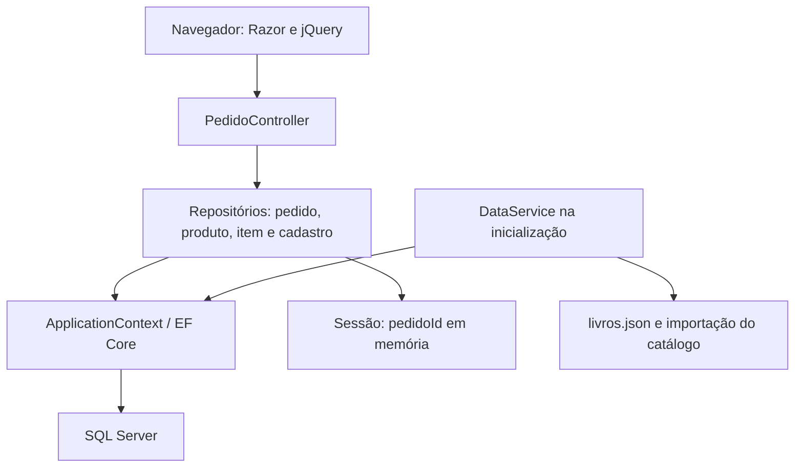

# .NET Developer — Casa do Código

Projeto de estudo em **C# e ASP.NET Core MVC**, desenvolvido durante a formação .NET da [Alura](https://cursos.alura.com.br/formacao-dotnet). O destaque é uma aplicação web de catálogo de livros com carrinho, cadastro do comprador e resumo do pedido, persistidos com Entity Framework Core e SQL Server.

O repositório registra exercícios de aprendizagem e um projeto final. Ele demonstra fundamentos de backend — injeção de dependência, persistência relacional, relacionamentos, sessão, validação e integração entre interface e servidor. **Não há evidências versionadas de operação em produção ou implantação em cloud.**

[Projeto final](WEB/ASPNET%20Core_Part%202/CasaDoCodigo) · [Solução](WEB/ASPNET%20Core_Part%202/CasaDoCodigo.sln) · [Execução](#como-executar-localmente) · [Testes](#testes-e-validação) · [Evolução](#próximos-passos)

## Visão rápida para avaliação técnica

| Aspecto | O que este projeto demonstra |
| --- | --- |
| Domínio | Catálogo de livros, carrinho e cadastro para resumo do pedido. |
| Backend | C# com ASP.NET Core MVC, DI, sessão e validação no servidor. |
| Dados | EF Core, SQL Server e relacionamentos entre pedido, itens, produtos e cadastro. |
| Ponto de entrada | `WEB/ASPNET Core_Part 2/CasaDoCodigo`, executado em ambiente compatível com .NET Core 2.0. |
| Validação disponível | Código e demonstração visual; sem suíte automatizada ou execução confirmada nesta revisão. |

**Percurso sugerido:** explore o fluxo principal e os arquivos da arquitetura, reproduza a aplicação localmente e use as limitações e próximos passos como roteiro para evolução. Para uma leitura rápida, o projeto final é o foco; as demais soluções preservam as etapas de aprendizagem.

## Funcionalidades implementadas

- Catálogo carregado de `livros.json` e persistido no banco na inicialização.
- Criação e recuperação de pedido por identificador armazenado na sessão.
- Inclusão de produtos no carrinho; adicionar novamente o mesmo produto não incrementa sua quantidade.
- Alteração de quantidade por AJAX, recálculo de subtotais e total e remoção quando a quantidade chega a zero.
- Formulário de dados pessoais e endereço, com Data Annotations e verificação de `ModelState` no servidor.
- Persistência do cadastro e apresentação do resumo do pedido.

O fluxo termina no resumo: não foram encontrados pagamento, integração de frete, controle de estoque ou estados de processamento do pedido.

### Demonstração visual


O GIF ilustra a interface; a implementação e as limitações estão descritas abaixo. Ele não comprova o estado atual de execução nem uma implantação pública.

## Organização do repositório

| Diretório | Conteúdo |
| --- | --- |
| [Banco de Dados](Banco%20de%20Dados) | Aplicação console de exercícios de EF Core, consultas, relacionamentos e migrations; projeto direcionado ao .NET Framework 4.6.1. |
| [WEB/ASPNET Core_Part 1](WEB/ASPNET%20Core_Part%201) | Aplicação de lista de leitura, com exemplos de roteamento, MVC e repositórios CSV/fake. |
| [WEB/ASPNET Core_Part 2](WEB/ASPNET%20Core_Part%202) | Projeto final Casa do Código, foco desta documentação. |

As soluções são independentes; não existe uma solução única na raiz.

## Tecnologias do projeto final

| Tecnologia | Evidência no código |
| --- | --- |
| C# / .NET Core 2.0 | `TargetFramework=netcoreapp2.0` em [CasaDoCodigo.csproj](WEB/ASPNET%20Core_Part%202/CasaDoCodigo/CasaDoCodigo.csproj). |
| ASP.NET Core MVC | Metapacote `Microsoft.AspNetCore.All` 2.0.9, controllers, views Razor e rotas convencionais. |
| Entity Framework Core / SQL Server | `ApplicationContext`, `UseSqlServer`, consultas LINQ, `Include`/`ThenInclude` e `SaveChanges`. |
| Sessão e cache em memória | `AddSession`, `AddDistributedMemoryCache` e chave de sessão `pedidoId`. |
| Newtonsoft.Json | Leitura do catálogo JSON em `Models/Livro.cs`. |
| Razor, Bootstrap e jQuery | Views, layout e atualização do carrinho em `wwwroot/js/Carrinho.js`. |

Essas são as tecnologias presentes no código legado; não representam uma migração para uma versão atual do .NET.

## Arquitetura

Aplicação monolítica MVC em um único projeto, organizada por responsabilidades em pastas. Os repositórios concentram tanto acesso a dados quanto parte das regras do carrinho; não há projetos separados de domínio, aplicação e infraestrutura.



| Responsabilidade | Onde consultar |
| --- | --- |
| Configuração de MVC, DI, sessão, banco e rotas | [Startup.cs](WEB/ASPNET%20Core_Part%202/CasaDoCodigo/Startup.cs) |
| Entrada das requisições e escolha das views | [PedidoController.cs](WEB/ASPNET%20Core_Part%202/CasaDoCodigo/Controllers/PedidoController.cs) |
| Recuperação do pedido, inclusão e atualização de itens | [PedidoRepository.cs](WEB/ASPNET%20Core_Part%202/CasaDoCodigo/Repositories/PedidoRepository.cs) |
| Mapeamento de entidades e relacionamentos | [ApplicationContext.cs](WEB/ASPNET%20Core_Part%202/CasaDoCodigo/ApplicationContext.cs) |
| Criação inicial do banco e importação de livros | [DataService.cs](WEB/ASPNET%20Core_Part%202/CasaDoCodigo/DataService.cs) |
| Interação AJAX e atualização dos totais na tela | [Carrinho.js](WEB/ASPNET%20Core_Part%202/CasaDoCodigo/wwwroot/js/Carrinho.js) |

### Modelo de dados

- `Pedido` possui uma coleção de `ItemPedido` e um `Cadastro`.
- `ItemPedido` referencia o pedido e o produto; guarda quantidade e preço unitário, com subtotal calculado.
- `Produto` representa os livros disponíveis no catálogo.
- `Cadastro` armazena os dados do comprador e o endereço daquele pedido; não representa uma conta autenticada.

### Escolhas observadas e suas implicações

Não há registros de decisão arquitetural (ADRs). As implicações abaixo são uma leitura da implementação, não uma atribuição de intenções ao autor.

| Escolha presente | Implicação |
| --- | --- |
| Interfaces e registro dos repositórios na DI | Dependências explícitas nos construtores; facilita substituir colaboradores em futuros testes. |
| EF Core com carregamento de itens, produtos e cadastro | Permite montar o pedido e suas views usando o modelo relacional. |
| Identificador do pedido na sessão | Dispensa login no exercício; a associação depende da sessão do navegador. |
| Cache de sessão em memória do processo | Reiniciar a aplicação perde a associação em memória, embora os pedidos continuem no SQL Server; não há cache compartilhado configurado entre instâncias. |
| `EnsureCreated()` na inicialização | Facilita criar uma base vazia; não aplica migrations nem oferece evolução controlada do esquema existente. |
| Data Annotations e antiforgery nos POSTs indicados | Há validação de cadastro e proteção antiforgery, mas isso não substitui autorização ou validação das regras do carrinho. |

## Fluxo principal

1. Na inicialização, `DataService.InicializarDB()` executa `EnsureCreated()`, lê `livros.json` e adiciona produtos cujos códigos ainda não existem.
2. `GET /` usa a rota padrão `Pedido/Carrossel` e exibe os produtos.
3. `/Pedido/Carrinho?codigo=001` adiciona o produto informado, caso ainda não esteja no pedido. `GetPedido()` recupera o pedido pela sessão ou cria um novo e grava seu ID.
4. O JavaScript envia ID do item e quantidade para `POST /Pedido/UpdateQuantidadePedido`, com token antiforgery. O servidor persiste a alteração e devolve os dados para atualizar a tela.
5. `/Pedido/Cadastro` apresenta o formulário. `POST /Pedido/Resumo` verifica o cadastro, atualiza seus dados e renderiza o resumo. Cadastro inválido redireciona para o formulário, sem preservar explicitamente os erros no retorno.

## Como executar localmente

### Pré-requisitos

- Git.
- Ambiente compatível com o projeto `netcoreapp2.0`, incluindo SDK e runtime correspondentes e acesso à restauração dos pacotes NuGet.
- Para usar a configuração original: **Windows e SQL Server Express LocalDB**, instância `(localdb)\MSSQLLocalDB`.
- Visual Studio com suporte à carga de trabalho ASP.NET é uma alternativa à CLI, desde que compatível com esse projeto legado.

Um SDK moderno, sozinho, não garante a execução deste projeto. Para evoluí-lo, a migração do framework e dos pacotes deve ser uma mudança separada e validada.

### Passos pela CLI

Execute os comandos no PowerShell:

```powershell
git clone https://github.com/fernandojs8/.Net-Developer.git
Set-Location ".Net-Developer/WEB/ASPNET Core_Part 2/CasaDoCodigo"

$env:ASPNETCORE_ENVIRONMENT = "Development"
dotnet restore
dotnet build
dotnet run
```

Abra o endereço exibido no terminal. Execute a partir da pasta do projeto: o catálogo é lido pelo caminho relativo `livros.json`.

A conexão padrão fica em [appsettings.json](WEB/ASPNET%20Core_Part%202/CasaDoCodigo/appsettings.json) e usa autenticação integrada, banco `CasaDoCodigo` e LocalDB. A aplicação precisa de permissão para criar a base e gravar seus dados.

Para usar outra instância SQL Server, substitua a configuração por variável de ambiente antes de executar:

```powershell
# Exemplo para SQL Server local com autenticação integrada no Windows.
# Ajuste servidor e autenticação ao seu ambiente.
$env:ConnectionStrings__Default = "Server=localhost;Database=CasaDoCodigo;Integrated Security=True;"
dotnet run
```

Não versione credenciais. LocalDB não é uma opção de banco para hospedar a aplicação em cloud.

### Inicialização do banco e diagnóstico

- A inicialização atual usa `EnsureCreated()`, embora existam arquivos em `Migrations/`. Não trate esse fluxo como aplicação automática de migrations.
- Para uma reprodução inicial, use uma base vazia de desenvolvimento. Em uma base existente, avalie o esquema antes de qualquer alteração; não exclua dados para resolver incompatibilidades.
- Falha de conexão: confira a instância SQL Server/LocalDB, a autenticação e as permissões.
- Erro ao ler `livros.json`: confira o diretório de execução.
- Falha de SDK/runtime ou restauração: confira a compatibilidade com o alvo e os pacotes antigos.
- A rota de tratamento de erros fora de Development aponta para `/Home/Error`, mas não há `HomeController` no código versionado; esse caminho precisa de correção antes de uma implantação.

**Validação desta documentação:** os passos foram derivados dos arquivos do repositório. Build e execução não foram realizados no ambiente de análise, pois o comando `dotnet` não está disponível. Não há confirmação de execução atual.

## Testes e validação

Não foi encontrada uma suíte automatizada com xUnit, NUnit ou MSTest. Apesar do nome, `Alura.Loja.Testes.ConsoleApp` é uma aplicação console de exercícios de persistência; não comprova cobertura automatizada do projeto final.

### Roteiro manual proposto — ainda não executado nesta revisão

1. Iniciar com banco de desenvolvimento vazio e conferir o catálogo.
2. Adicionar um produto; repetir a inclusão e confirmar que não duplica nem incrementa o item.
3. Alterar a quantidade e conferir subtotal e total; usar zero e confirmar a remoção.
4. Preencher o cadastro com dados fictícios e conferir os dados e itens no resumo.
5. Enviar cadastro inválido e observar o redirecionamento e a perda de mensagens de validação.
6. Abrir uma sessão independente e confirmar que recebe outro pedido.

### Testes automatizados a acrescentar

- **Unidade:** subtotal, total e regras de quantidade, incluindo rejeição de valores negativos.
- **Integração com SQL Server:** persistência e recuperação dos relacionamentos, importação repetida do catálogo e remoção de itens.
- **HTTP/segurança:** antiforgery, produto inexistente, ID de item inexistente e tentativa de alterar item pertencente a outra sessão.
- **Fluxo completo:** catálogo → carrinho → cadastro → resumo, com resultados reproduzíveis no CI.

Esses testes são próximos passos; não há relatório de cobertura ou resultado de pipeline para apresentar.

## Limitações conhecidas

Pontos identificados por leitura estática, sem exploração em uma aplicação em execução:

- **Autorização de itens:** a atualização consulta o item apenas por ID, sem verificar se pertence ao pedido da sessão. É necessário restringir essa operação antes de expor a aplicação publicamente.
- **Quantidades:** `AtualizarQuantidade` atribui diretamente o valor recebido; não há regra de rejeição de negativos nem limite superior.
- **Produto inexistente:** `AddItem` chama `produtoEncontrado.Equals(null)`; se a consulta retornar nulo, isso pode gerar `NullReferenceException`.
- **Mutação via GET:** a action `Carrinho` pode adicionar produtos por uma requisição GET. A inclusão deve passar a POST com proteção antiforgery.
- **Checkout simplificado:** o resumo não implementa pagamento, confirmação definitiva, encerramento do carrinho ou processamento de pedidos.
- **Persistência:** criação automática da base na inicialização, operações síncronas e ausência de estratégia documentada para concorrência e evolução de esquema.
- **Operação:** não foram encontrados Dockerfile, pipeline de CI/CD, infraestrutura como código, health checks ou evidências de deploy.
- **Observabilidade:** há configuração de logging e referência a um snippet do Application Insights no layout, mas isso não comprova telemetria configurada, coletada ou monitorada.

## Próximos passos

Ordem proposta para transformar o exercício em uma demonstração backend/cloud verificável:

1. **Correção funcional e segurança:** validar propriedade dos itens e quantidades, tratar nulos, mover inclusão para POST, preservar erros do formulário e corrigir a rota de erro.
2. **Atualização tecnológica:** migrar framework e dependências para uma versão suportada escolhida na implementação, com testes de regressão e SDK fixado.
3. **Qualidade reproduzível:** criar os testes acima e CI com restore, build e testes; publicar resultados reais.
4. **Persistência previsível:** definir migrations como fluxo de evolução, separar seed de demonstração e documentar configuração e recuperação do banco.
5. **Demonstração em cloud:** escolher a hospedagem, automatizar provisionamento e deploy e validar sessão, configuração, TLS e acesso ao banco.
6. **Operação demonstrável:** instrumentar requisições e dependências, criar health checks, alertas e um procedimento testado de rollback.

### Evidências de cloud/produção a adicionar

As opções abaixo são propostas, **não componentes já implementados**. Uma implantação de demonstração deve ser identificada como tal; não implica uso comercial, usuários reais ou experiência operacional em produção.

| Evidência a construir | O que publicar no repositório |
| --- | --- |
| Arquitetura implantada | Diagrama dos recursos efetivamente usados, região, comunicação com o banco e justificativa das escolhas. Em Azure, uma opção a avaliar é App Service + Azure SQL. |
| Infraestrutura reproduzível | Bicep ou Terraform dos recursos reais, instruções de provisionamento/remoção e estimativa de custo com premissas. |
| Deploy rastreável | Workflow de CI/CD, link de execução bem-sucedida e associação entre commit, artefato e versão implantada. |
| Configuração e identidade | Nomes das configurações necessárias e descrição da autenticação; se adotados, demonstrar identidade gerenciada e Key Vault sem publicar valores secretos. |
| Demonstração acessível | URL HTTPS, versão/commit, data de validação e roteiro com dados fictícios. |
| Observabilidade | Capturas sanitizadas ou consultas de logs, latência e falhas; se adotado, mostrar uma requisição correlacionada no Application Insights. |
| Escalabilidade da sessão | Registrar a solução realmente testada para múltiplas instâncias e reinícios, incluindo cache compartilhado e configuração necessária de proteção de dados. |
| Desempenho medido | Script de carga, cenário, infraestrutura, duração, volume, p95 e taxa de erro. Não declarar capacidade sem medição. |
| Recuperação operacional | Procedimento e evidência de rollback e de restauração de backup em ambiente de teste. |

Adicione badges somente quando houver pipelines ou relatórios reais. Não publique credenciais, dados pessoais, capturas de clientes ou métricas inventadas.

## Origem e licença

Projeto desenvolvido no contexto da formação .NET da Alura. Esta documentação distingue o conteúdo educacional existente das melhorias propostas.

Código disponibilizado sob a [licença MIT](LICENSE).
