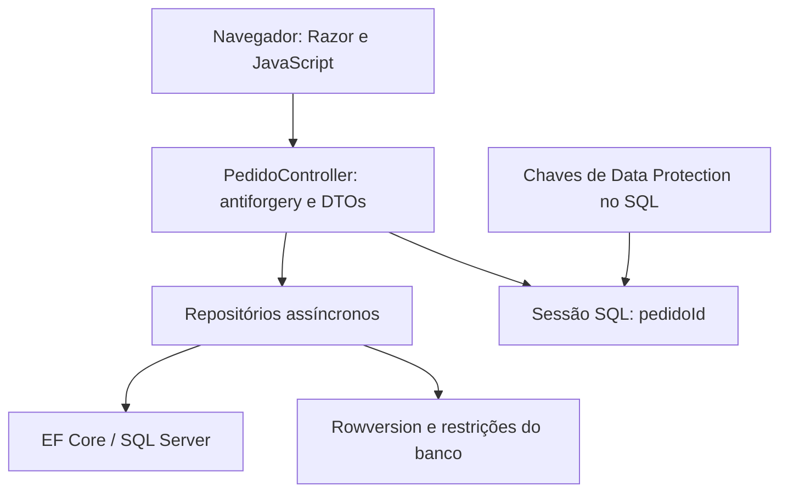

# .NET Developer — Casa do Código

Aplicação MVC de catálogo de livros, carrinho e cadastro para resumo do pedido. O projeto final da formação .NET da [Alura](https://cursos.alura.com.br/formacao-dotnet) foi modernizado para **C# / .NET 10 / ASP.NET Core MVC / EF Core 10 / SQL Server**. As demais soluções preservam os exercícios históricos.

[Aplicação](WEB/ASPNET%20Core_Part%202/CasaDoCodigo) · [Testes](WEB/ASPNET%20Core_Part%202/CasaDoCodigo.Tests) · [CI](.github/workflows/ci.yml) · [Azure](docs/azure.md) · [Operação](docs/operations.md)

## Roteiro implementado

| Próximo passo do README anterior | Mudança |
| --- | --- |
| Correção funcional e segurança | Item sempre consultado pelo pedido da sessão; DTOs de entrada; quantidade de 0 a 99; nulos tratados; inclusão por POST com antiforgery; formulário inválido preservado; rota de erro válida. |
| Atualização tecnológica | Projeto final em .NET 10, EF Core 10.0.14 e SDK selecionado em `global.json`; remoção do metapacote ASP.NET Core 2 e do snippet de telemetria antigo. |
| Qualidade reproduzível | Testes unitários, HTTP/SQL reais e CI com build, testes, publicação e cenário em containers. |
| Persistência previsível | Migrations explícitas, seed separado e repetível, índices únicos, check de quantidade e rowversion para alterações concorrentes. |
| Preparação de demonstração cloud | Bicep para App Service/Azure SQL/Key Vault/Monitor, workflow manual com OIDC, staging, verificação HTTPS e promoção por swap. A implantação real exige configuração da conta Azure. |
| Operação | Health checks, logs estruturados, instrumentação OpenTelemetry/SQL, alerta HTTP 5xx no template Azure e ensaio automatizado de rollback em containers. |

O projeto continua sendo uma demonstração: não processa pagamentos, frete, estoque ou um checkout comercial. Não há autenticação de usuários; o carrinho pertence à sessão anônima. Use dados fictícios.

## Funcionalidades e arquitetura

- Catálogo importado de `livros.json` apenas pelo comando explícito de seed.
- Inclusão de um produto no carrinho sem duplicar o item nem incrementar ao repetir o POST.
- Atualização de quantidade com recálculo e remoção quando chega a zero.
- Cadastro validado no servidor, seguido pelo resumo do pedido.
- Sessão distribuída e chaves de proteção no SQL Server, compartilhadas entre instâncias.



O monólito usa projetos/pastas históricos do curso, sem inventar uma arquitetura de microsserviços. `Pedido` referencia `Cadastro` e itens; cada item referencia um produto e guarda preço unitário e quantidade. DTOs evitam vincular o grafo EF diretamente aos dados recebidos.

### Fluxo HTTP

1. `GET /` exibe o catálogo, com formulários POST de inclusão.
2. `POST /Pedido/Adicionar` exige token antiforgery, procura o produto e associa o item ao pedido da sessão.
3. `GET /Pedido/Carrinho` apenas exibe o carrinho; parâmetro `codigo` não inclui produtos.
4. `POST /Pedido/UpdateQuantidadePedido` exige antiforgery, ID, quantidade e rowversion. Item de outra sessão retorna 404; valor inválido retorna 400; versão desatualizada retorna 409.
5. `GET /Pedido/Cadastro` mostra o formulário. `POST /Pedido/Resumo` valida os dados e preserva valores/erros se inválidos.

O resumo não encerra a sessão nem confirma pagamento. A consulta GET do carrinho pode criar um pedido vazio para a sessão; a inclusão de produto é exclusivamente POST.

## Executar com Docker Compose

Pré-requisitos: Docker com Compose v2 em um host compatível com a imagem SQL Server. Para o smoke, Python 3 e curl.

```bash
git clone https://github.com/fernandojs8/.Net-Developer.git
cd .Net-Developer
cp .env.example .env
# Escolha uma senha local no .env.
docker compose up --build -d
```

O ambiente tem SQL Server, um job separado de migrations/seed e duas instâncias web:

| Serviço | Endereço |
| --- | --- |
| Aplicação | http://localhost:5080 |
| Segunda instância | http://localhost:5081 |
| Liveness | `/health/live` |
| Readiness de SQL, catálogo, sessão e chaves | `/health/ready` |

As portas ficam vinculadas ao localhost. O banco e as chaves são preservados no volume. `LocalHttp=true` é usado somente no Compose; em cloud, HTTPS e cookie Secure permanecem habilitados.

```bash
python3 scripts/smoke.py
# Somente em ambiente descartável: injeta imagem quebrada e recupera a versão conhecida.
python3 scripts/smoke.py --rollback
docker compose logs -f web web2
docker compose down
```

O smoke cria um carrinho, usa a outra instância e reinicia a aplicação, verificando a continuidade da sessão. A opção de rollback para as instâncias web e troca suas imagens; não a execute num ambiente compartilhado com usuários.

## Executar pelo SDK

A [solução da raiz](CasaDoCodigo.sln) inclui apenas o projeto final modernizado e seus testes. Os projetos antigos de banco de dados e da primeira etapa web ficam fora dela.

```bash
dotnet restore CasaDoCodigo.sln
dotnet build CasaDoCodigo.sln -c Release
```

Defina `ConnectionStrings__Default` para seu SQL Server. Em desenvolvimento HTTP local, defina `LocalHttp=true`; em HTTPS use o certificado de desenvolvimento. Execute a partir da pasta publicada/projeto, com `livros.json` no content root:

```bash
dotnet run --project "WEB/ASPNET Core_Part 2/CasaDoCodigo" -- --migrate
dotnet run --project "WEB/ASPNET Core_Part 2/CasaDoCodigo" -- --seed
dotnet run --project "WEB/ASPNET Core_Part 2/CasaDoCodigo"
```

Nenhum schema ou seed é aplicado automaticamente ao subir o servidor. Configure apenas um job de migração/seed por implantação. Não versione credenciais.

### Bancos legados

As migrations históricas foram preservadas. A nova migration adiciona cache de sessão, chaves, rowversion e índices/restrições. Ela recusa dados duplicados, quantidades inválidas e valores maiores que os novos limites, em vez de apagá-los/truncá-los silenciosamente.

**Bases criadas com `EnsureCreated()` não têm histórico de migrations.** Não aplique a sequência inicial cegamente: faça backup, compare o schema e planeje um baseline revisado conforme [o runbook](docs/operations.md). Uma base vazia de demonstração pode seguir a sequência normalmente.

## Testes e evidências

```bash
dotnet test CasaDoCodigo.sln -c Release
```

Sem infraestrutura, apenas os testes unitários rodam; integração aparece como ignorada. Para executar HTTP/SQL reais, disponibilize um SQL Server de teste com permissão para criar/remover bases:

```bash
export RUN_INTEGRATION_TESTS=true
export TEST_SQL='Server=localhost;User Id=sa;Password=YOUR_LOCAL_PASSWORD;TrustServerCertificate=True'
dotnet test CasaDoCodigo.sln -c Release
```

A suíte cria uma base exclusiva e a remove ao terminar. Cobre total/subtotal e limites, antiforgery, mutação apenas por POST, produto/item inexistente, acesso de outra sessão, versão concorrente, remoção de item, seed repetido, validação do formulário e fluxo catálogo → carrinho → cadastro → resumo. Também abre outra instância com as mesmas chaves/sessão SQL.

O [CI](.github/workflows/ci.yml) executa testes com SQL Server, publica o app, roda Compose com duas instâncias e ensaia rollback de uma imagem deliberadamente quebrada. Resultados TRX ficam como artifacts nos [runs reais](https://github.com/fernandojs8/.Net-Developer/actions). O template Bicep é compilado em outro job; isso não equivale a recursos provisionados.

Validação da mudança e links de execução estão no PR correspondente. Não há métrica de cobertura, carga, p95 ou capacidade inventada.

## Cloud e operação

A opção preparada é **Azure App Service Linux Standard S1 + Azure SQL Basic**, com Key Vault, identidade gerenciada para leitura do segredo e Application Insights/Log Analytics. O deploy manual cria/atualiza recursos, aplica migrations fora do processo web, publica em staging, verifica readiness por HTTPS e promove por swap. Um alerta de 5xx usa o email do operador configurado.

Consulte [configuração e custos](docs/azure.md) e [backup, restauração, rollback e diagnóstico](docs/operations.md). Provisionamento exige assinatura, resource group, federação OIDC, variáveis e segredo SQL; esses dados não foram presumidos. Não se afirma implantação pública, experiência de produção ou alerta já disparado.

## Limitações restantes

- A sessão anônima não é uma conta autenticada. Não use dados reais de clientes numa demonstração pública.
- Sessão SQL e chaves compartilhadas permitem continuidade entre processos; requisições simultâneas que criam o primeiro carrinho da sessão ainda podem gerar pedidos vazios órfãos. Rowversion evita sobrescrever quantidades desatualizadas; um conflito pede recarregamento.
- Armazenar sessão, dados e chaves no mesmo SQL simplifica a demonstração, mas compartilha carga e acesso administrativo. As chaves XML precisam de proteção adicional e política de acesso em ambientes com dados sensíveis.
- O frontend preserva Bootstrap/jQuery históricos do curso. Atualização completa dos assets e testes de navegador são uma evolução separada; a validação de servidor não depende desses scripts.
- O template Azure usa endpoints públicos e regra SQL para serviços Azure; restrinja rede/identidade e permissões SQL antes de dados reais. O usuário SQL de provisionamento não é uma identidade de execução com privilégio mínimo.
- Não há testes de carga, backup/restauração Azure executados ou evidência de deploy cloud até que o ambiente seja configurado.

## Origem e licença

Estudos da Alura, com exercícios históricos em `Banco de Dados` e `WEB/ASPNET Core_Part 1`. Código sob [MIT](LICENSE).
